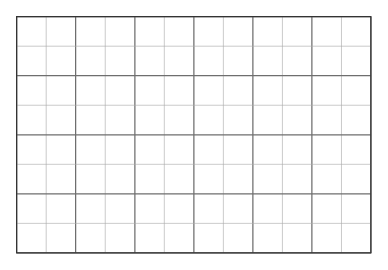
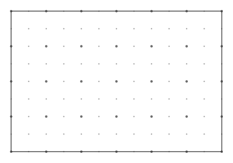
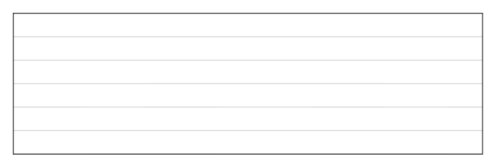
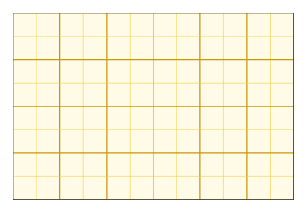

# meshpad

Configurable grid backgrounds for printable worksheets, in [Typst](https://typst.app),
drawn with [CeTZ](https://github.com/cetz-package/cetz). Square grid, ruled paper
(horizontal or vertical lines only) or dot grid, with an optional darker "major"
line/dot every N steps — the classic look of engineering/milimetrado paper.

<p align="center">
  
  
</p>
<p align="center">
  
  
</p>

## Usage

```typ
#import "@preview/meshpad:0.1.0": grid-paper

#grid-paper(size: (6, 4), kind: "square", step: 0.5, major-every: 2)
```

This is exactly the first image in the gallery above. Use it standalone, wrapped
in a `box`/`place` behind other content, or as a whole-page background —
`meshpad` doesn't need to know about pages, Typst already handles that:

```typ
#set page(background: grid-paper(size: (21, 29.7), step: 0.5, major-every: 2))
```

## Parameters

| Parameter      | Default   | Meaning |
|----------------|-----------|---------|
| `size`         | `(10, 10)`| `(width, height)`. Plain numbers are CeTZ units (cm by convention), but you can pass explicit Typst lengths instead — `(5cm, 3cm)`, `(4in, 3in)`, etc. |
| `kind`         | `"square"`| `"square"` (lines) or `"dot"` (dot grid). |
| `lines`        | `"both"`  | `"both"`, `"horizontal"` or `"vertical"` — only meaningful for `kind: "square"`; `"horizontal"` gives ruled/pautado paper. |
| `step`         | `0.5`     | Spacing between minor lines/dots. Same rule as `size`: a plain number is cm, or pass an explicit length like `5mm`. |
| `major-every`  | `none`    | Every Nth line/dot is drawn as "major" (thicker/darker). `none` disables it. |
| `background`   | `none`    | Fill color behind the pattern. `none` is transparent. |
| `color`        | `gray`    | Color of minor lines/dots. |
| `major-color`  | `none`    | Color of major lines/dots. `none` defaults to a darker shade of `color`. |
| `frame`        | `true`    | Draw a border around the rectangle. |

## Compatibility

- Typst `>= 0.14.0`
- CeTZ `0.5.2`

## Known limitations

See [`ROADMAP.md`](ROADMAP.md). In short: no isometric grid yet.

## License

[MIT](LICENSE).
